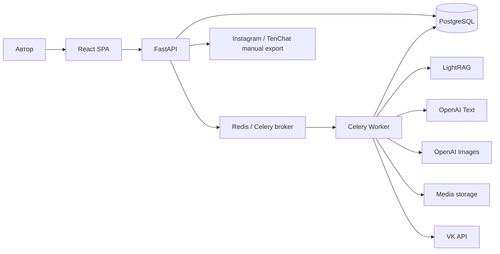
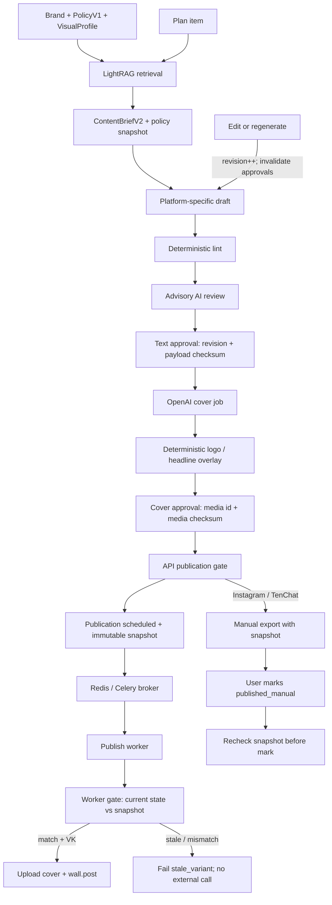
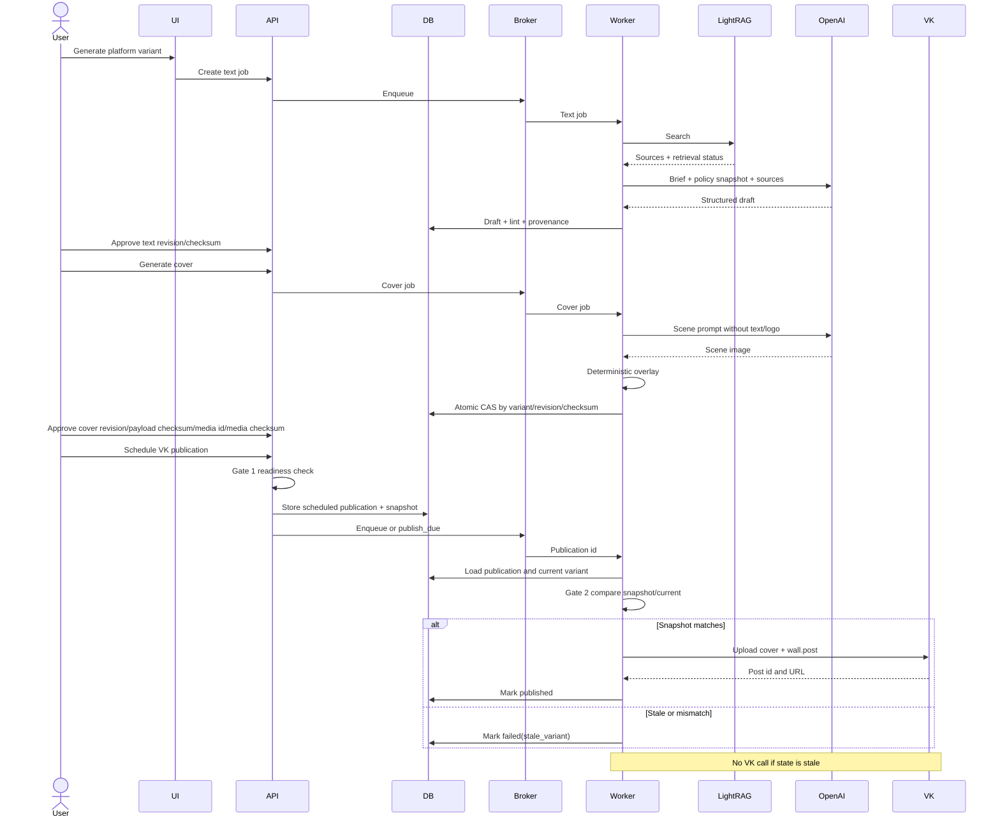

# План оптимизации контента Nodex для VK, Instagram и TenChat

Дата: 17.10.2026
Статус: план согласован, реализация не начата

## 1. Цель

Перенести в ContentForge лучшие практики из `C:\Python\Projects\tenChat` и адаптировать генерацию под особенности VK, Instagram и TenChat. Добавить генерацию обложек OpenAI Images в едином стиле Nodex Dark Cinematic High Tech с обязательным ручным подтверждением.

MVP должен давать не один универсальный текст, а отдельный вариант для каждой платформы, проверенный по её правилам, источникам LightRAG и привязанным к ревизии подтверждениям текста и обложки.

### Архитектурные допущения

- Существующие PostgreSQL, Redis/Celery, MediaAsset и Job остаются системными компонентами; новый отдельный сервис не создаётся.
- `ContentVariant.revision` уже существует и становится частью approval/publication semantics, а не создаётся заново.
- Текущее media storage подходит для MVP; переход в object storage не меняет `MediaAsset` contract.
- OpenAI Images доступен worker через серверный secret и поддерживает асинхронный job lifecycle.
- TenChat long-form в MVP является экспериментальным профилем: он использует общий grounded article contract и подтверждённые social-prинципы tenChat, но не объявляется подтверждённой методологией статьи.
- Instagram и TenChat не имеют автоматического publish adapter в MVP; их конечный путь — manual export.
- Один пользователь может подтверждать текст и обложку; разделение ролей остаётся расширением.

Влияние допущений: C4 сохраняет текущие контейнеры; DFD разводит автоматический VK и manual export; contracts используют существующие Job/MediaAsset/revision; NFR требует storage abstraction, чтобы открытый вопрос о backend хранения не ломал API.

## 2. Зафиксированный scope

### В MVP

- платформы: VK, Instagram, TenChat;
- отдельные policy и prompt для каждой платформы;
- grounding через LightRAG с явным статусом результата;
- платформенный content brief до генерации текста;
- детерминированный lint и рекомендательная AI-оценка;
- ручное подтверждение текста;
- генерация квадратной обложки через OpenAI Images;
- детерминированное наложение логотипа и заголовка;
- ручное подтверждение обложки;
- публикация VK с изображением;
- ручной экспорт Instagram и TenChat;
- единый publication gate для всех путей публикации и экспорта;
- совместимость со старыми строковыми `platform_policies`.

### Не входит в MVP

- автопубликация Instagram и TenChat;
- аналитика результатов публикаций;
- автоматическая запись новых материалов в LightRAG;
- форматы обложек 4:5 и 16:9;
- отдельная таблица только для image jobs;
- обязательная блокировка публикации по субъективной AI-оценке;
- полноценный TenChat API;
- самостоятельная методология long-form статей из tenChat-репозитория: её там нет.

## 3. Подтверждённые выводы исследования

### 3.1. Практики из tenChat, которые нужно перенести

Перед написанием текста обязательны:

1. сегмент аудитории;
2. конкретная боль;
3. результат, который читатель унесёт;
4. уникальная сцена или деталь из практики;
5. действие, применимое в течение 48 часов.

Рекомендуемая структура:

- hook или сцена в первых 1–2 строках;
- боль;
- конкретный эпизод;
- личная практика или доказательство;
- вывод;
- чеклист из трёх пунктов либо 2–3 критерия;
- CTA с выбором 1/2 или спорным тезисом.

Контроль качества:

- ясность;
- узнаваемая боль;
- конкретная сцена;
- практическая польза;
- естественный тон;
- уникальность;
- CTA;
- оформление под платформу.

Редакторское решение для каждого фрагмента: оставить, вырезать или переписать.

LightRAG используется как обязательный фактический gate в режимах, где grounding помечен `required`. Пустой или недоступный поиск нельзя выдавать за успешное обоснование. Автоматический upsert в базу знаний запрещён.

### 3.2. Ограничения найденной методики

- В tenChat нет отдельной подтверждённой методологии для больших статей.
- В старых материалах встречается мягкий вопрос в CTA, а актуальные правила предпочитают выбор 1/2.
- Наблюдения основаны на небольшой выборке, поэтому платформенные лимиты и lint должны быть конфигурируемыми.
- Рекомендации TenChat нельзя механически применять к VK и Instagram.

### 3.3. Текущее состояние ContentForge

- `social_post` уже использует LightRAG, platform policy и quality lint.
- `article` и `email` работают через legacy prompt без LightRAG и quality lint.
- генерация плана не использует platform policy и LightRAG;
- `platform_policies` хранятся как свободный `dict[str, str]`;
- UI не позволяет полноценно редактировать структурированные policy;
- модель social post уже содержит `headline`, `lead`, `scene`, `takeaway`, `cta`, `hashtags`, `alt_text`, но Editor показывает не все поля;
- `MediaAsset` и upload существуют, генерации AI-изображений нет;
- Telegram уже умеет работать с media;
- VK публикует только текст;
- Instagram и TenChat работают вручную;
- ручной schedule может обходить approval и quality checks;
- provenance сейчас частично хранится в `_meta`.

## 4. Целевая платформенная логика

### VK

- форматы MVP: social post и article-like long post;
- лимит итогового текста: не более 4096 символов;
- поддержка обложки;
- автопубликация текста и изображения через VK API;
- CTA и hashtags формируются по VK policy.

### Instagram

- формат MVP: social caption/post;
- статья как тип контента запрещена policy;
- обязательны caption, релевантные hashtags, alt text и квадратная обложка;
- только ручной экспорт в MVP.

### TenChat

- форматы MVP: social post и экспериментальный long-form материал;
- social-структура следует подтверждённым практикам tenChat;
- long-form использует общий grounded article contract и проходит отдельную проверку golden corpus;
- лимиты остаются конфигурируемыми;
- только ручной экспорт в MVP.

## 5. Визуальное направление Nodex

### Основной стиль

- направление: Dark Cinematic High Tech;
- фон: глубокий navy/black;
- акценты: cyan и electric blue;
- основной текст и логотип: white;
- эффекты: controlled glow, HUD-контуры, технологические интерфейсы;
- сюжет: человек, AI/robot, smartphone или рабочая сцена;
- композиция: один главный фокус, без перегруженного мелкого UI.

Референсы:

- `C:\Python\Projects\tenChat\assets\tenchat-ok-vs-podtverzhdayu-cover.jpg`;
- `C:\Python\Projects\tenChat\assets\tenchat-bot-3s-vs-rewrites-v2.jpg`;
- `C:\Python\Projects\tenChat\assets\nodex-logo-hightech.jpg`;
- `C:\Python\Projects\tenChat\assets\nodex-logo-hightech.png`.

### Правила обложки

- master: 1024×1024;
- export: 1080×1080;
- центральная safe zone для основного объекта;
- AI генерирует сцену без текста и логотипа;
- точный логотип Nodex накладывается программно;
- заголовок опционален, максимум 6 слов;
- текст и логотип накладываются детерминированно через Pillow;
- обязательное ручное подтверждение;
- не более трёх генераций на одну ревизию текста.

Так устраняются типовые дефекты генераторов: искажённый логотип, неверные буквы, нечитаемый мелкий текст и обрезание важных объектов.

## 6. Архитектура

### 6.1. C4 — контейнерный уровень

### 6.2. DFD — подготовка, подтверждение и публикация

### 6.3. Sequence — асинхронная генерация и безопасная публикация

## 7. Контракты и модель данных

### 7.1. PlatformPolicyV1

Обязательные поля:

- `schema: platform_policy_v1`;
- `platform`;
- `allowed_content_types`;
- правила hook, body, CTA, длины, hashtags и media;
- детерминированные quality rules;
- `grounding_requirement: off | optional | required`;
- допустимые retrieval statuses;
- `extra_instructions`.

Правила совместимости:

- legacy-строка нормализуется в `extra_instructions`;
- V1 пишется в новое nullable-хранилище `platform_policies_v1`, старое поле не перезаписывается в MVP;
- dual-read выбирает V1 при включённом flag, иначе читает legacy и нормализует в памяти;
- backfill идемпотентно создаёт V1, но не удаляет исходную строку;
- вариант контента хранит immutable snapshot использованной policy и её версию.

### 7.2. ContentBriefV2

Поля:

- target platform;
- content type и format;
- audience segment;
- pain;
- scene seed;
- proof/source references;
- takeaway;
- CTA mode;
- image concept;
- retrieval status;
- policy snapshot/version;
- prompt versions.

Brief является входным контрактом между планом, retrieval и генератором. Нельзя формировать платформенный текст напрямую из одной темы.

### 7.3. ContentVariant

Добавить или закрепить:

- target platform;
- существующий revision как обязательную основу approval lifecycle;
- policy snapshot;
- payload checksum;
- text approval: revision, checksum, time, user;
- `cover_media_id` как единственный source of truth;
- cover state: text revision, payload checksum, media id, media checksum, visual profile version, prompt hash, job id, approval time и user.

`payload_checksum` определяется однозначно:

- алгоритм: SHA-256;
- вход: canonical JSON в UTF-8 с сортировкой ключей, нормализованными переводами строк и без незначащих пробелов;
- включаются только публикуемые поля structured variant: `headline`, `lead`, `scene`, `body`, `text`, `body_markdown`, `takeaway`, `cta`, `hashtags`, `alt_text`, `title`, `excerpt`, `seo_title`, `seo_description`, `slug`, `target_platform` и `content_type`;
- исключаются mutable `_meta`, provenance, lint/review, approval, timestamps, job state и media state;
- одна canonicalization-функция используется edit, approve, export, schedule и publish worker.

Любое редактирование публикуемых полей или перегенерация текста:

1. увеличивает revision;
2. создаёт новый checksum;
3. сбрасывает text approval;
4. сбрасывает cover approval;
5. помечает прежнюю обложку stale, сохраняя её для аудита.

Перегенерация только обложки не меняет text revision или payload checksum и не сбрасывает text approval. Она заменяет current `cover_media_id`, сбрасывает только cover approval и расходует одну из трёх cover generations для текущей text revision.

### 7.4. BrandVisualProfile

Поля:

- preset `nodex_dark_hightech`;
- palette;
- style prompt;
- negative prompt;
- `logo_media_id`;
- safe zone;
- overlay policy;
- version.

### 7.5. Jobs и MediaAsset

- Использовать существующий generic Job, добавив тип `generate_cover`.
- Результат сохранять как MediaAsset.
- Не создавать отдельную таблицу image jobs в MVP.
- Завершение job обновляет текущую обложку только атомарным compare-and-set по `variant_id + revision + payload_checksum`.
- Результат stale job остаётся orphan asset и удаляется через 7 дней.
- Cover approval валиден только при одновременном совпадении revision, payload checksum, текущего `cover_media_id` и фактического `MediaAsset.checksum`.

### 7.6. Migration plan

1. Добавить nullable V1/policy snapshot/checksum/approval/cover поля без изменения legacy reads.
2. Развернуть dual-read с выключенными feature flags.
3. Выполнить идемпотентный backfill V1 и payload checksums, сохранив legacy data.
4. Включить shadow comparison legacy/V1 и собрать расхождения.
5. Включить V1 read/write только в новом nullable поле для Nodex; legacy поле остаётся неизменным rollback snapshot.
6. Перед central gate временно заморозить создание новых schedule/retry, дождаться terminal state существующих queued/scheduled jobs либо отменить их с требованием явного reschedule.
7. Проверить, что активных legacy publications без snapshot не осталось.
8. После приёмки включить revision-bound approvals и central gate.
9. В MVP не удалять legacy columns/data и не grandfather-ить публикации без snapshot.

Rollback: выключить flags, читать нетронутое legacy поле, оставить новые nullable данные неактивными. Изменения policy, сделанные только в V1 во время пилота, экспортируются в audit report, но не перезаписывают legacy автоматически. Down migration удалять не требуется; повторный backfill безопасен.

## 8. API-контракты

Пути фиксируют design contract; при конфликте с текущим router допускается только механическое переименование без изменения semantics.

### Policy

- `GET /brands/{brand_id}/platform-policies/{platform}` → `200 { policy, source: "v1"|"legacy_normalized", version }`.
- `PUT /brands/{brand_id}/platform-policies/{platform}` с `{ expected_version, policy: PlatformPolicyV1 }` → `200` с новой версией.
- Ошибки: `400 invalid_policy`, `404 brand_not_found`, `409 version_conflict`, `422 unsupported_content_type`.

### Вариант и job

- `POST /plan-items/{plan_item_id}/variants` с `{ platform, content_type, editor_instructions? }` → `202 { job_id }`.
- `GET /jobs/{job_id}` → `200 { status, result_ref?, error_code?, retryable }`.
- `GET /variants/{variant_id}` → `200 { brief, variant, revision, payload_checksum, policy_snapshot, provenance, quality, approvals, cover }`.
- Ошибки: `400 invalid_platform`, `409 generation_in_progress`, `422 grounding_required`, `429 generation_limit`, `503 grounding_unavailable`.

### Quality и text approval

- `POST /variants/{variant_id}/quality-review` с `{ expected_revision, expected_payload_checksum }` → `200 { blockers, warnings, advisory_scores }`.
- `POST /variants/{variant_id}/approve-text` с `{ expected_revision, expected_payload_checksum }` → `200 { approved_at, approved_by }`.
- Ошибки: `409 stale_variant`, `422 quality_blocked`.

### Обложка

- `POST /variants/{variant_id}/covers` с `{ expected_revision, expected_payload_checksum, visual_profile_version }` → `202 { job_id }`.
- `GET /variants/{variant_id}/covers/current` → `200 { media_id, media_checksum, state, provenance, stale }`.
- `POST /variants/{variant_id}/covers/{media_id}/approve` с `{ expected_revision, expected_payload_checksum, expected_media_checksum }` → `200`.
- Ошибки: `409 stale_variant|cover_generation_in_progress`, `422 text_not_approved|invalid_media`, `429 cover_generation_limit`.

### Publication и manual export

- `POST /variants/{variant_id}/publications` с `{ channel_id, schedule_at?, expected_revision, expected_payload_checksum, expected_cover_media_id, expected_cover_checksum }` → `201 { publication_id, status }`.
- `POST /publications/{publication_id}/retry` → `202`, сохраняя исходный immutable snapshot.
- `POST /variants/{variant_id}/exports` с `{ platform, expected_revision, expected_payload_checksum, expected_cover_media_id, expected_cover_checksum }` → `200 { publication_id, package }`.
- `POST /publications/{publication_id}/mark-published-manual` с `{ external_url? }` → `200`, только после повторной snapshot-проверки.
- Ошибки: `409 stale_variant|stale_cover|publication_exists`, `422 publication_not_ready|adapter_unsupported|platform_channel_mismatch`.

`package` имеет фиксированную схему:

- `platform`, `content_type`, `title?`, `text`, `hashtags[]`, `alt_text?`;
- `revision`, `payload_checksum`, `policy_version`;
- `cover: { media_id, media_checksum, download_url, filename, mime_type, expires_at } | null`;
- `download_url` — короткоживущая server-generated ссылка, `filename` санитизирован, `mime_type` проверен;
- export package immutable и соответствует snapshot в `Publication.meta`.

Capability contract адаптера:

- `supports_text`, `supports_media`, `supports_schedule`, `supports_auto_publish`, `supports_manual_export`;
- gate отклоняет операцию, если обязательная capability равна `false`.

### Publication gate

`assert_publication_ready()` вызывается:

- при ручном schedule;
- при auto schedule;
- при retry;
- при manual export;
- в publish worker непосредственно перед внешним API.

Проверки:

- platform варианта совпадает с типом канала;
- content type и format разрешены policy snapshot;
- grounding requirement выполнен;
- retrieval status допустим;
- deterministic blockers отсутствуют;
- text approval совпадает с revision/checksum;
- обязательная cover approval совпадает с revision/payload checksum, текущим `cover_media_id` и `MediaAsset.checksum`;
- adapter поддерживает требуемую операцию.

Publication сохраняет прошедшие gate revision, payload checksum, policy version, cover media id и cover checksum в metadata.

## 9. Quality model

### Hard blockers

- запрещённый тип контента;
- превышение жёсткого platform limit;
- отсутствующий required grounding;
- недопустимый retrieval status;
- пустой результат;
- отсутствующая обязательная сцена, takeaway или CTA;
- нет text approval;
- нет cover approval при обязательной обложке;
- approval относится к другой revision/checksum;
- cover approval относится к другому media id/checksum;
- platform/channel mismatch;
- adapter не поддерживает операцию.

### Warnings

- слабый hook;
- общий текст без уникальной детали;
- чрезмерно формальный или нейросетевой тон;
- слишком много hashtags;
- слабая практическая применимость;
- длинный заголовок обложки;
- риск нечитаемости на мобильном preview.

AI rubric остаётся рекомендацией. Она не может самостоятельно блокировать публикацию из-за недетерминированности.

## 10. Security и эксплуатационные ограничения

- Ключи OpenAI и платформ хранятся только в `.env`/secret storage.
- Prompt, sources и model metadata не должны содержать секреты.
- Проверять MIME, фактический формат, dimensions и размер файла до 15 MB.
- Не принимать произвольные пути для logo или output.
- Санитизировать filename и metadata.
- Ограничить cover generation: максимум 3 на variant revision.
- Ограничить concurrency: один активный image job на бренд.
- Лимиты и concurrency проверяются атомарно в БД, а не только настройками Celery.
- Retry: максимум 2, только transport errors, 429 и 5xx.
- Timeout OpenAI Images: 120 секунд.
- Все approval, regeneration, export и publication gate decisions пишутся в audit log.
- Manual export не считается фактической публикацией до явного `published_manual`.

## 11. NFR

- идемпотентность publish worker и retry;
- отсутствие внешнего вызова при stale state;
- обратная совместимость с legacy policy;
- наблюдаемость по job id, variant revision и publication id;
- трассируемость model, prompt version, policy version и sources;
- контролируемая стоимость генерации изображений;
- graceful degradation при недоступном optional LightRAG;
- hard failure при недоступном required LightRAG;
- UI не блокируется асинхронной генерацией;
- миграции выполняются без потери существующих вариантов и media.

## 12. План реализации

### Межэтапный gate

Следующий этап начинается только после того, как:

1. выполнены все проверки текущего этапа;
2. результат и evidence записаны в worklog;
3. QA даёт `pass` без замечаний middle+;
4. для миграций и внешних API подтверждён rollback/contingency;
5. незакрытые low-risk замечания явно перенесены в backlog.

При `fail` работа остаётся на текущем этапе; переход дальше запрещён.

### Этап 0. Golden corpus и baseline

**Цель:** получить измеримую точку отсчёта до изменения prompt и pipeline.

**Входы:**

- 12–18 реальных тем Nodex;
- существующие варианты ContentForge;
- лучшие посты и правила из tenChat;
- текущие platform policies.

**Действия:**

1. Выбрать по 4–6 тем для VK, Instagram и TenChat.
2. Зафиксировать текущий output, источники, latency и ручные правки.
3. Составить эталонную rubric: platform fit, specificity, evidence, usefulness, tone, CTA.
4. Сохранить expected hard blockers и допустимые warnings.

**Проверки:**

- в корпусе представлены три платформы и social/long-form форматы;
- оценки воспроизводимы двумя проходами редактора;
- зафиксированы исходные latency и число ручных правок.

**Ожидаемый результат:** regression corpus и baseline metrics.

**Rollback/contingency:** если реальных примеров недостаточно, использовать синтетические темы только для edge cases и не включать их в quality benchmark.

**Предполагаемые зоны:** тестовые fixtures и внутренние evaluation scripts; production code не меняется.

### Этап 1. PolicyV1, BriefV2 и миграционная совместимость

**Цель:** заменить свободные инструкции на валидируемые платформенные контракты.

**Входы:** текущие `platform_policies`, AI schemas, content profile, platform limits.

**Действия:**

1. Ввести discriminated schema PlatformPolicyV1.
2. Ввести ContentBriefV2.
3. Добавить normalizer legacy string → V1.
4. Добавить отдельное nullable V1-хранилище, dual-read и идемпотентный backfill без перезаписи legacy поля.
5. Добавить policy snapshots и versioning.
6. Подготовить Nodex presets для VK, Instagram и TenChat.
7. Добавить feature flag `platform_policy_v1_enabled`.

**Проверки:**

- все legacy policy читаются;
- новые policy проходят schema validation;
- Instagram отклоняет article;
- VK ограничивает article-like post до 4096;
- snapshot не меняется после редактирования brand policy.
- flag off читает исходный legacy policy после V1 update;
- повторный backfill не меняет уже мигрированный результат.

**Ожидаемый результат:** типизированный source of truth платформенных правил.

**Rollback/contingency:** выключить flag и читать нетронутое legacy поле; V1 и backfill остаются неактивными, старые значения не удаляются.

**Предполагаемые зоны:** `ai_schemas.py`, content profile schemas/services, brand settings API, migrations, tests.

### Этап 2. Platform-aware plan и LightRAG brief

**Цель:** планировать отдельные намерения под каждую платформу до генерации текста.

**Входы:** PlanItem, PolicyV1, content profile, LightRAG.

**Действия:**

1. Расширить plan item audience, pain, takeaway, scene seed и image concept.
2. Применять effective policy при создании плана.
3. Выполнять retrieval до draft generation.
4. Явно сохранять `success`, `empty`, `unavailable`, `skipped`.
5. Запрещать имитацию grounding при empty/unavailable.
6. Не выполнять автоматический KB upsert.

**Проверки:**

- одинаковая тема даёт разные briefs для трёх платформ;
- required grounding блокируется на empty/unavailable;
- optional grounding продолжает работу с warning;
- sources и retrieval status доступны в UI/API.

**Ожидаемый результат:** ContentBriefV2 с policy и evidence provenance.

**Rollback/contingency:** оставить текущую генерацию плана под flag; при optional LightRAG использовать ungrounded warning, при required — fail.

**Предполагаемые зоны:** plan generation в `ai_jobs.py`, `content_brief.py`, `knowledge_grounding.py`, schemas, tests.

### Этап 3. Платформенная генерация social posts

**Цель:** создавать отдельный структурированный вариант для VK, Instagram и TenChat.

**Входы:** ContentBriefV2, sources, policy snapshot, prompt versions.

**Действия:**

1. Разделить prompt templates по платформам.
2. Сохранить общий structured output contract.
3. Для каждой платформы настроить hook, body, CTA, hashtags, alt text и limits.
4. Включить обязательную уникальную сцену и 48-hour action.
5. Исключить нейрошаблоны и универсальные версии.
6. Версионировать prompts.

**Проверки:**

- golden corpus проходит hard rules;
- варианты одной темы различаются структурой и подачей;
- output schema стабилен при retry;
- лимиты считаются по финально собранному тексту.

**Ожидаемый результат:** пригодные к редактированию platform-native варианты.

**Rollback/contingency:** переключение на текущий social_post v2 по feature flag; старые варианты остаются читаемыми.

**Предполагаемые зоны:** `ai_jobs.py`, prompt builders, `ai_schemas.py`, `content_quality.py`, tests.

### Этап 4. Long-form track

**Цель:** привести статьи к тому же grounded и проверяемому pipeline.

**Входы:** ContentBriefV2, PolicyV1, ArticleAI, LightRAG sources.

**Действия:**

1. Убрать legacy-only путь article.
2. Добавить retrieval, policy snapshot и lint.
3. Для TenChat добавить экспериментальный long-form profile на общей article schema без заявления о подтверждённой отдельной методологии.
4. Для VK собирать article-like post до 4096 символов.
5. Для Instagram возвращать deterministic validation error.
6. Отдельно версионировать long-form prompts.

**Проверки:**

- статья содержит traceable sources;
- VK никогда не превышает лимит;
- Instagram не запускает лишний AI job;
- TenChat export сохраняет структуру и checksum.
- TenChat long-form отдельно сравнивается с golden corpus и не наследует неподтверждённые жёсткие правила.

**Ожидаемый результат:** единый lifecycle social и long-form контента.

**Rollback/contingency:** оставить legacy article read-only; новую генерацию выключать отдельным flag.

**Предполагаемые зоны:** article branch в `ai_jobs.py`, schemas, quality, export service, tests.

### Этап 5. Quality и revision-bound approval lifecycle

**Цель:** исключить публикацию изменённого или непроверенного контента.

**Входы:** ContentVariant, deterministic lint, advisory review.

**Действия:**

1. Закрепить существующий revision в approval semantics и добавить однозначный payload checksum.
2. Привязать text approval к revision/checksum.
3. Сбрасывать оба approval при edit/text regenerate; при cover regenerate сохранять text approval и сбрасывать только cover approval.
4. Разделить blockers, warnings и advisory AI scores.
5. Добавить audit trail.
6. Добавить feature flag `central_publication_gate_enabled`.

**Проверки:**

- редактирование одной буквы инвалидирует approval;
- повтор старого approval получает conflict;
- checksum не меняется от обновления `_meta`, lint, approval или timestamps;
- checksum меняется при изменении любого публикуемого social или article поля;
- cover regeneration не меняет text revision/checksum и не сбрасывает text approval;
- AI score сам по себе не блокирует;
- deterministic blocker невозможно обойти manual schedule.

**Ожидаемый результат:** однозначно подтверждённая ревизия текста.

**Rollback/contingency:** gate сначала работает в shadow mode с логированием; затем enforcement включается по бренду.

**Предполагаемые зоны:** models, migrations, content service, quality service, approval API, audit, tests.

### Этап 6. OpenAI Images и High Tech cover pipeline

**Цель:** генерировать брендированные обложки Nodex без искажённого текста и логотипа.

**Входы:** approved variant, image concept, BrandVisualProfile, logo MediaAsset.

**Действия:**

1. Добавить visual profile preset Nodex.
2. Добавить async job `generate_cover`.
3. Генерировать сцену без text/logo.
4. Валидировать MIME, размер и dimensions.
5. Наложить logo и короткий headline через Pillow.
6. Создать 1080×1080 export.
7. Сохранить provenance, usage и estimated cost.
8. Завершать job атомарным CAS.
9. Добавить quota, DB concurrency lock и orphan cleanup.
10. Добавить feature flag `cover_generation_enabled`.

**Проверки:**

- одновременно работает не более одного image job на бренд;
- четвёртая генерация одной revision отклоняется;
- stale job не заменяет актуальную cover;
- approval другого media id/checksum не проходит gate;
- logo воспроизводится пиксельно корректно;
- safe zone сохраняется;
- transport retry не создаёт duplicate current cover.

**Ожидаемый результат:** подтверждаемая обложка, привязанная к ревизии текста.

**Rollback/contingency:** выключить AI generation и оставить ручной upload через существующий MediaAsset; orphan assets очищаются отдельно.

**Предполагаемые зоны:** jobs, media service, OpenAI client, Pillow compositor, storage, models/migrations, worker, tests.

### Этап 7. Central publication gate, VK media и manual export

**Цель:** закрыть обходы проверок и доставлять готовый контент корректным способом.

**Входы:** approved text/cover, policy snapshot, channel, adapter capabilities.

**Действия:**

1. Реализовать единый `assert_publication_ready()`.
2. Подключить его ко всем schedule, retry и export путям.
3. Сохранять immutable publication snapshot.
4. Перед enforcement заморозить новые schedule/retry и drain/cancel все legacy publications без snapshot.
5. Повторять gate в worker перед внешним API.
6. Добавить VK image upload и attachment к wall post.
7. Добавить manual export packages для Instagram/TenChat.
8. Перед `published_manual` повторно сверять snapshot.
9. Сделать publication/retry идемпотентными.

**Проверки:**

- manual schedule не обходит gate;
- stale publication не вызывает VK API;
- VK получает текст и ровно нужную обложку;
- platform/channel mismatch блокируется;
- manual export содержит revision/payload checksum, cover media id/checksum и media;
- retry не создаёт дубликат поста.
- перед enforcement отсутствуют queued/scheduled legacy publications без snapshot;
- legacy publication без snapshot не grandfather-ится и требует reschedule.

**Ожидаемый результат:** безопасная публикация VK и проверяемый ручной workflow двух остальных платформ.

**Rollback/contingency:** отключить VK media attachment и сохранить text-only adapter; central gate сначала включать по бренду после shadow-проверки.

**Предполагаемые зоны:** `publish_service.py`, VK adapter, publication models, channel capabilities, export endpoints, worker, tests.

### Этап 8. Frontend

**Цель:** сделать весь lifecycle понятным и управляемым из UI.

**Входы:** новые policy, brief, quality, approval, media и publication endpoints.

**Действия:**

1. Добавить structured platform policy editor.
2. Показать audience, pain, scene, takeaway, sources и retrieval status.
3. Показать отдельные platform tabs/variants.
4. Вывести blockers, warnings и advisory review раздельно.
5. Добавить text approval с revision indicator.
6. Добавить cover preview, regenerate count и approval.
7. Показывать stale approvals после edit.
8. Добавить manual export action для Instagram/TenChat.
9. Сохранить RU/EN i18n.

**Проверки:**

- пользователь видит, почему publication заблокирована;
- смена brand загружает его policy и visual profile;
- edit немедленно показывает stale state;
- невозможно подтвердить старую revision;
- mobile preview читаем.

**Ожидаемый результат:** end-to-end редактор без скрытых состояний.

**Rollback/contingency:** новые блоки UI скрываются feature flags; существующий Editor остаётся доступным.

**Предполагаемые зоны:** `EditorPage.tsx`, `SettingsPage.tsx`, API types/client, i18n, component tests.

### Этап 9. QA, security, rollout и production verification

**Цель:** безопасно включить новый pipeline без регрессий текущей публикации.

**Входы:** результаты этапов 0–8, migrations, feature flags.

**Действия:**

1. Прогнать unit, integration и end-to-end tests.
2. Проверить race: edit во время cover job и перед VK call.
3. Проверить 429/5xx/timeout и retries.
4. Проверить secret leakage, upload validation и path handling.
5. Сравнить golden corpus с baseline.
6. Включить policy/quality в shadow mode для Nodex.
7. Включать flags последовательно: policy → cover → central gate.
8. Выполнить production smoke test на тестовом VK post.
9. Проверить health и audit trail.

**Проверки:**

- все тесты зелёные;
- нет middle+ замечаний review/security;
- stale race не вызывает внешнего API;
- стоимость image generation ограничена;
- quality benchmark не хуже baseline и требует меньше ручных правок;
- production health возвращает 200.

**Ожидаемый результат:** новый pipeline включён для Nodex и наблюдаем.

**Rollback/contingency:** выключать flags в обратном порядке; откат БД не удаляет snapshots/assets; при проблемах VK вернуться к text-only; ручной export остаётся аварийным путём.

**Предполагаемые зоны:** backend/frontend test suites, deployment config, observability, worklog.

### Post-MVP backlog

После накопления реальных данных:

- published thesis map против повторения тем;
- аналитика результатов по platform/content type;
- рекомендации на основе реальных публикаций;
- first-hour reminder и workflow ответов;
- 4:5 для Instagram;
- 16:9 для внешних статей;
- A/B варианты hook и cover;
- автопубликация Instagram после отдельной проверки API/permissions;
- revisable long-form methodology на основе собственной выборки Nodex.

## 13. Порядок feature flags

1. `platform_policy_v1_enabled`;
2. `cover_generation_enabled`;
3. `central_publication_gate_enabled`.

Каждый flag сначала включается на dev/test, затем на Nodex в shadow mode, после проверки — в enforcement. Массовое включение до прохождения golden corpus и race tests запрещено.

## 14. Definition of Done MVP

- Для одной темы создаются разные VK, Instagram и TenChat briefs/variants.
- Каждый variant содержит policy, prompt и source provenance.
- Required LightRAG не может тихо перейти в ungrounded generation.
- Hard blockers детерминированы и покрыты тестами.
- Любой edit инвалидирует text и cover approvals.
- Nodex cover создаётся в согласованном High Tech стиле.
- Логотип и headline накладываются без генеративных искажений.
- Stale cover job не меняет актуальный variant.
- Все publication/export пути проходят единый gate.
- Publish worker повторяет gate перед VK API.
- VK публикует текст с подтверждённой обложкой.
- Instagram/TenChat export содержит точную подтверждённую ревизию.
- Legacy content и policies продолжают читаться.
- Golden corpus показывает улучшение platform fit без роста blocker rate.
- Unit/integration/E2E проверки зелёные, production health — 200.

## 15. Открытые вопросы перед coding

Они не блокируют архитектуру, но должны быть закрыты перед соответствующим этапом:

1. Какой точный logo asset считать каноническим для deterministic overlay?
2. Нужен ли headline на всех обложках или только для отдельных content types?
3. Какие soft limits TenChat закрепить после проверки первых 20 публикаций?
4. Где хранить generated media в production: текущий media storage или object storage?
5. Какой бюджет на OpenAI Images установить на бренд в день/месяц?
6. Нужен ли отдельный reviewer role или подтверждает текущий автор?

## 16. Итоговый приоритет

Критический путь:

`PolicyV1 → ContentBriefV2 + LightRAG → platform prompts → revision approvals → cover pipeline → centralized publication gate → VK media/manual export → UI → rollout`.

Нельзя начинать с одной генерации картинки: без revision-bound approvals и central gate обложка может быть опубликована с другой версией текста. Нельзя начинать с UI: сначала нужны устойчивые контракты и migration compatibility.
